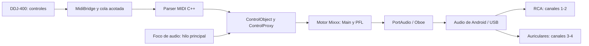

> Documento generado autónomamente por un agente de IA. Requiere revisión humana antes de publicación.

# Diagnóstico del port Android de Mixxx

Fecha: 11 de octubre de 2026. Base revisada: `bfa498b8f7`, rama `skin-jaqlife`,
más las modificaciones locales de esta revisión. Versión preparada:
**0.7.1 (Comic Book Guy)**, `versionCode=10`.

## Evaluación

El proyecto es un **port experimental funcional con una base de audio madura**.
Mixxx aporta el motor DSP, controles, biblioteca, efectos, sincronización y
mapeos. El principal trabajo para convertirlo en un producto profesional está
en la integración Android, la compatibilidad de dispositivos, la experiencia
táctil y la disciplina de pruebas y distribución.

La preescucha independiente de la DDJ-400 sigue siendo un bloqueo para usar esta
combinación en una sesión profesional. El usuario ya confirmó sonido por RCA y
auriculares y un fallo persistente de CUE. Las correcciones previas de frecuencia
y apertura multicanal no resolvieron la última prueba física reportada.

El alcance de esta revisión incluye las modificaciones del port respecto al
snapshot importado, puentes Java/JNI, entrada MIDI, apertura de audio y foco,
arranque y permisos, integración de la skin, shaders, scripts, workflows y
documentación. La validación combina lectura de código, inspección del binario,
pruebas de regresión en el host y compilación Android. Las mediciones físicas de
latencia, nivel analógico, temperatura y separación USB siguen pendientes.

## Arquitectura y puntos de fallo

Un CUE activo en MIDI no prueba que la señal llegue al par físico 3–4.
Un stream solicitado con cuatro canales tampoco certifica cuatro salidas
independientes. Hay que medir el punto en que Main/PFL pierden su separación.

Las nuevas mediciones y el foco se ejecutan fuera del callback de audio. El
parser MIDI usa memoria acotada. La cola Java pertenece a la entrada MIDI, no
al hilo de audio del motor.

## Bugs corregidos en esta revisión

| Problema comprobado | Consecuencia | Corrección y evidencia |
|---|---|---|
| SysEx sin `F0` ni `F7` en `AndroidMidiController` | Los mapeos reciben mensajes inválidos. Un SysEx vacío podía llegar a `data.at(0)` con un array vacío. | Parser portable que conserva delimitadores, admite realtime intercalado y descarta mensajes desbordados completos. Siete pruebas C++. |
| Callback de apertura MIDI posterior al timeout o interrupción | Se pierde la referencia al dispositivo abierto y quedan recursos sin dueño. | `PendingMidiOpen` transfiere o cierra el recurso exactamente una vez. Seis escenarios Java, con 500 carreras entre timeout y callback. |
| Apertura parcial de puertos presentada como éxito | Un controlador puede figurar habilitado aunque falte el puerto que entrega botones y perillas. | Se exigen todos los puertos solicitados y se cierran recursos si falla la apertura. Compilación Java/Android. |
| `ConcurrentLinkedQueue.size()` en cada recepción | Recorre la cola y no impone un límite de capacidad por sí mismo. | `ArrayBlockingQueue` acotada. Ante desbordamiento o flush, una marca reinicia el parser para descartar fragmentos incompletos. |
| Ajuste anterior con `setWillPauseWhenDucked(false)` | Android podía atenuar el audio automáticamente sin llamar al listener. | El listener recibe `CAN_DUCK`; Mixxx conserva reproducción y nivel ante ese aviso. Las pérdidas reales/transitorias siguen pausando. |
| Foco asociado solo a decks presentes al arrancar | Samplers, biblioteca y reproductores agregados después no obtenían la misma protección. | Seguimiento de los contadores de decks, samplers y preview y registro de nuevos controles `play`. |
| Pausa de varios reproductores con señales reentrantes | Al pausar el primero, los demás podían provocar otra solicitud de foco, incluso después de una denegación. | Guardia durante la pausa y abandono explícito; se ignoran ganancias de foco de solicitudes ya abandonadas. |
| Permiso USB comparado por identidad del objeto Java | El `UsbDevice` recibido mediante parcel puede ser otro objeto; el resultado no coincide con el esperado. | Comparación por nombre del dispositivo y consumo del resultado una sola vez. Se elimina el procesamiento de eventos dentro del mutex. Pendiente prueba HID/Bulk física. |
| Registro de receiver con flags nuevos sin distinguir API | La integración de permisos dependía de APIs recientes para todos los Android anunciados. | Selección del overload según SDK. Compilación Android; pendiente ejecución en una futura build compatible con Android antiguo. |
| Almacenamiento usa APIs de Android 11 sin condición | En Android anteriores no existe la misma pantalla ni `isExternalStorageManager`. | Puente con rama por SDK, permisos legacy de lectura/escritura y fallback si falta la pantalla de ajustes. Compilación Android. |
| Afinidad fija al núcleo 4 | Restringe el hilo que inicializa PortAudio; no identifica el hilo de audio ni garantiza un núcleo adecuado. | Se retira la afinidad y se deja la selección al scheduler del dispositivo. Compilación nativa. |
| APK renombrado 0.7.1 con versión interna 0.7-beta y código 9 | El usuario y soporte no pueden identificar qué build está instalada. | Metadatos únicos en `release.json`; CMake y script producen versión 0.7.1, personaje y código 10. El script rechaza APKs con otros datos. |
| Argumentos Android configurados como propiedad que el macro local no lee | Al usar el placeholder del manifest, los argumentos quedaban vacíos. | Se usa la variable `QT_ANDROID_APPLICATION_ARGUMENTS`, que el macro Qt instalado serializa en el JSON de despliegue. |
| Manifest anuncia API 28 y código nativo enlaza API 35 | Android antiguo puede permitir instalar una app cuyo motor no puede cargar. | Mínimo declarado API 35; CMake rechaza un mínimo inferior al API nativo. Validación de SDK mínimo dentro del APK. |
| Documentación desactualizada y cifras sin trazabilidad | Se anunciaban modelos, memoria, ausencia de jank y compatibilidad sin una matriz reproducible. | README corregido: estado físico actual, mínimo real y métricas pendientes. |

En el binario principal se comprobaron imports obligatorios de
`APerformanceHint_setPreferPowerEfficiency`, `backtrace@LIBC_T`,
`copy_file_range@LIBC_U` y `pthread_cond_clockwait@LIBC_R`, entre otros.
La primera función exige API 35. Cambiar solo el manifest a API 28 no crea
compatibilidad: los símbolos nativos se resuelven al cargar la biblioteca.
Referencias: [SDK y NDK](https://developer.android.com/ndk/guides/sdk-versions),
[Performance Hint](https://developer.android.com/ndk/reference/group/a-performance-hint).

## Prioridades pendientes

P0 bloquea la fiabilidad en sesión. P1 debe resolverse antes de anunciar estabilidad.
P2 mejora distribución, mantenimiento y experiencia tras cerrar lo anterior.

| Prioridad | Área y evidencia | Trabajo concreto y criterio de aceptación |
|---|---|---|
| **P0** | CUE DDJ-400: último fallo físico persiste. `headMix` no se mapea bajo la hipótesis de mezcla en hardware. | Registrar Main/PFL y ruta efectiva con DDJ conectada. Pistas distintas, deck B con fader abajo, PFL solo B: B únicamente en PHONES; A únicamente en RCA. Validar MIXING y MASTER CUE. Cambiar mapeo o transporte según la medición. |
| **P1** | Desconexión y reconexión: enumeradores conservan una lista inicial; ControllerManager documenta que el escaneo ocurre al inicio. | Máquina de estados para retirada, cierre y recuperación de audio/MIDI; sincronizar con preferencias antes de reemplazar objetos. Veinte ciclos de conexión sin crash, bloqueo ni vuelta inesperada al altavoz. |
| **P1** | Ciclo de vida: manifest tiene `background_running`, pero no un servicio multimedia. | Integrar servicio en primer plano y sesión multimedia con el motor existente, controlar pantalla y energía y definir restauración. Probar Home, bloqueo, pantalla apagada, llamadas y retorno a Mixxx. |
| **P1** | Foco: ya cubre reproducción de pistas; micrófonos/auxiliares sin pistas quedan fuera. | Política para entradas en directo y estado visible al perder foco. Probar mix con dos decks, sampler, preview e input sin pistas. Android limita solicitudes en segundo plano para apps que apuntan a API 35 o superior. |
| **P1** | USB multicanal dependiente del teléfono/HAL; abrir Oboe con cuatro canales no certifica el cableado. | Perfil validado por dispositivo/controlador, comprobación de frecuencia/canales y rechazo explicativo de configuraciones incompatibles. Certificar parejas físicas, no solo enumeración. |
| **P1** | QA Android: scripts y matrix heredada desactivan `BUILD_TESTING`. | Ejecutar pruebas del motor en host, pruebas instrumentadas del port y regresiones físicas. El nuevo workflow solo cubre parser, apertura pendiente y metadatos; no sustituye esas capas. |
| **P1** | Interfaz: Pioneered fue diseñada para complementar un controlador, mantiene diálogos de escritorio y mínimo 480×420. | Auditar preferencias, permisos, teclado y selección de música en teléfonos/tablets. Definir uso con controlador y uso táctil autónomo. Navegación accesible, lectura legible y acciones críticas utilizables. |
| **P1** | Rendimiento: detección GPU lleva a 60 FPS; eso no mide margen térmico ni estabilidad. | Perfetto/heapprofd y medición de underruns, memoria y temperatura durante análisis de biblioteca y mezcla. Sesión de al menos dos horas con las funciones realmente admitidas, sin cortes ni crecimiento continuo de memoria. |
| **P1** | Firma/actualización: CI heredado genera clave temporal cuando faltan secrets. | Clave de release estable con respaldo, identidad verificada y separación entre artifacts de CI y builds actualizables. Actualizar APK conservando biblioteca y preferencias. |
| **P2** | Biblioteca y permisos: acceso global a archivos y ruta inicial fija `/storage/emulated/0/Music`. | Explorar MediaStore/SAF, archivos locales y SD/USB externos, enlaces persistentes y revocación de permisos. Guardar/restaurar biblioteca, playlists y ajustes y probar migraciones. |
| **P2** | Releases: hay pipeline Android heredado y artifact upload; no existe workflow específico que adjunte APKs a Releases de este fork. | Preparar proceso de release con tag, personaje único, código creciente, changelog, checksum, APK verificada y código fuente correspondiente. Revisar y publicar como acción humana tras QA físico. |
| **P2** | Mantenimiento upstream: `origin/main...HEAD` no tiene ancestro común; el código llegó como snapshot. | Registrar el commit upstream exacto y mantener los parches Android distinguibles. Elegir una estrategia de integración y ensayar actualización sin perder las correcciones del port. |
| **P2** | Dependencias: buildenv fijado por hash; Dependabot heredado apunta a rama `2.5`, no a la rama de trabajo actual. | Mantener inventario de Qt/Oboe/PortAudio/FFmpeg, revisar avisos de seguridad, actualizar en rama de integración y configurar automatizaciones del fork. |
| **P2** | Distribución pesada: APK anterior ~286 MiB. Bibliotecas ~217 MiB comprimidas, manual ~37 MiB. | Medir debug symbols y módulos Qt necesarios, excluir recursos de otras plataformas y evaluar manual descargable. Conservar avisos/licencias y símbolos de depuración externos. Medir el ahorro antes de cambiar funcionalidades. |
| **P2** | Soporte: logs útiles, pero no hay paquete versionado de diagnóstico/compatibilidad. | Exportación voluntaria de versión, rutas, errores y métricas; evitar datos de biblioteca innecesarios. Manual de conexión y recuperación y registro de problemas por build. |

Android puede mezclar otros sonidos aunque Mixxx mantenga foco; el foco no concede
exclusividad absoluta del dispositivo. Para una sesión que exija silenciar avisos,
el estado de No molestar del teléfono debe formar parte de la preparación.
La política de Mixxx conserva el nivel ante `CAN_DUCK`, pero una llamada o pérdida
de foco real sigue pudiendo interrumpir audio. [Foco de Android](https://developer.android.com/media/optimize/audio-focus).

## Orden de implementación

1. **Cerrar la ruta de audio.** Separación RCA/CUE, ganancias, frecuencia de
   44100 Hz en la DDJ-400, latencia y cambios de MIXING con evidencia física.
2. **Cerrar sesiones y dispositivos.** Lifecycle, retirada USB, reconexión,
   foco, entradas y recuperación sin sonidos inesperados.
3. **Definir el producto móvil.** Flujos táctiles, permisos, biblioteca,
   tablet/teléfono y funciones admitidas. Una migración completa a QML es una
   decisión de arquitectura; no es requisito por sí sola para ser profesional.
4. **Validar estabilidad y actualización.** Matriz de teléfonos y controladores,
   pruebas prolongadas, actualización de APK, restauración de datos y firma estable.
5. **Distribuir y mantener.** Releases revisadas, documentación, métricas de
   incidencias, calendario de dependencias y estrategia para integrar upstream.

Cada hito se cierra por evidencia y criterios de aceptación. Una estimación de
calendario necesita fijar dispositivos, funciones, responsables y presupuesto;
las pruebas actuales no justifican prometer una fecha de estabilidad.

## Pruebas preparadas y límites

`tools/test_android_port.sh` ejecuta:

- Siete pruebas C++ del parser: running status, mensajes de un byte, realtime,
  delimitadores SysEx, límite de tamaño, interrupciones y reset.
- Seis escenarios Java de propiedad/cierre de apertura MIDI, incluidos 500
  intentos concurrentes de timeout/callback.
- Siete pruebas Python: nombre público, metadatos válidos/invalidos, versión
  interna del APK, SDK mínimo y rechazo de firma fallida.

El script puede ejecutarse sin compilar todo Mixxx. El test C++ también se
registró en la suite normal de Mixxx. El nuevo workflow local usa permisos de
lectura y ejecuta estas regresiones al cambiar sus fuentes.

Se revisan además compilación nativa ARM64, empaquetado Java, firma, datos de
`aapt`, sintaxis de shell, YAML, XML y `git diff --check`. La suite completa de
Mixxx no se ejecuta en la configuración Android actual: `BUILD_TESTING=OFF`.
Existen 135 fuentes de tests C++ directamente en `src/test`, además de otras
en subdirectorios; la madurez heredada no equivale a cobertura del nuevo port.

La prueba física queda a cargo de una sesión real con la DDJ-400 y otras parejas
de hardware. La APK preparada es candidata a pruebas, no una certificación de
estabilidad. No se realizó publicación ni envío de cambios a GitHub en esta revisión.

Registro final de esta revisión: las siete pruebas C++, los seis escenarios Java
y las siete pruebas Python pasaron. La build nativa y el empaquetado finalizaron
correctamente. La APK firmada se verificó con `apksigner` y `aapt`: paquete
`org.mixxx`, versión `0.7.1 (Comic Book Guy)`, código 10, mínimo SDK 35. El manifest
generado contiene `--log-level info` y el checksum SHA-256 coincide. También pasaron
las comprobaciones de sintaxis de shell, XML/YAML y `git diff --check`.
Esta APK no se instaló en el celular durante la revisión.

## Proceso sostenible de release

Editar `packaging/android/release.json`: incrementar versión y `version_code`,
elegir otro personaje y conservar el mínimo compatible con las dependencias.
El nombre público sigue `Mixxx-Android-vVERSION-Personaje.apk`.

Ejecutar regresiones, compilar con `./build_android.sh` y comprobar actualización
desde la versión instalada con la misma clave. El script verifica firma, package,
versión interna y mínimo SDK antes de copiar el APK y escribir el SHA-256.

Conservar evidencia de QA, compatibilidad real y fallos conocidos para cada tag.
Respaldar la clave de firma de forma segura, conservar los símbolos externos,
documentar procedencia de dependencias y código fuente correspondiente. Designar
responsables de integración Android, pruebas físicas y releases; registrar
decisiones de arquitectura y reservar trabajo periódico para dependencias y bugs.

Según `AGENTS.md`, commit, push y publicación deben quedar como acciones humanas
deliberadas después de revisión y pruebas con equipo DJ real. La preparación
local y las comprobaciones automáticas ayudan a esa revisión.

> Fin del documento generado autónomamente por un agente de IA.
